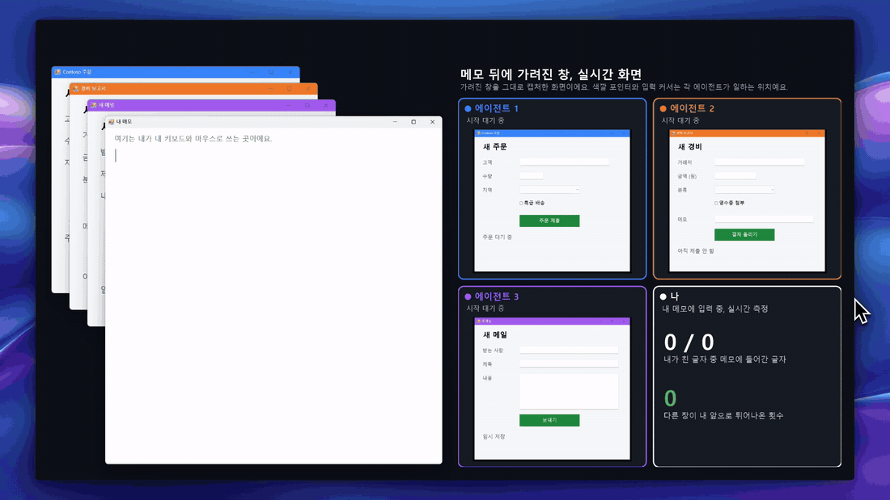

<p align="center">
  
</p>

<h1 align="center">Sidehand</h1>

<p align="center"><b>AI 에이전트는 뒤에서 Windows 앱을 다루고, 나는 하던 일을 계속합니다.</b></p>

<p align="center">
  <a href="https://www.npmjs.com/package/sidehand"></a>
  <a href="LICENSE"></a>
  
  
</p>

<p align="center"><a href="README.md">English</a> | <b>한국어</b> | <a href="README.zh-CN.md">简体中文</a></p>



Sidehand는 Claude, Codex, Cursor 같은 MCP 클라이언트가 지금 쓰고 있는 창 뒤의 Windows 앱을 읽고 조작하게 해 줍니다. 입력, 클릭, 목록 선택, 화면 읽기를 하면서도 내 마우스를 움직이거나 키보드를 가져가지 않습니다.

## 왜 Sidehand인가

- 벤치마크 작업 내내 메모 창이 키보드를 지켰습니다. 키보드를 뺏긴 시간 0초, 앞으로 나온 창 0개, 커서 이동 0번입니다.
- 내 창에 가려진 창에서 일하므로, 앞에 있는 창을 계속 쓸 수 있습니다.
- 컨트롤 하나를 짧은 한 줄로 돌려줍니다. 같은 작업에 Sidehand는 토큰 277개, 다른 도구는 2,488개에서 13,425개를 썼습니다. 창 하나를 읽을 때 agent-desktop보다 일반적인 앱에서 약 4배에서 5배, Edge 페이지에서 약 20배 적게 씁니다.
- 작업을 2.0초에 끝냈습니다. 작업을 끝낸 다른 도구인 Windows-MCP와 Terminator는 65.5초와 68.0초가 걸렸습니다.

## 시작하기

Windows 10 또는 11과 Node 18.3 이상이 필요합니다. MCP 클라이언트에 서버를 추가합니다.

```json
{
  "mcpServers": {
    "sidehand": { "command": "npx", "args": ["-y", "sidehand", "mcp"] }
  }
}
```

| 클라이언트 | 넣는 곳 |
|---|---|
| Claude Code | `claude mcp add sidehand -- npx -y sidehand mcp` |
| Cursor | `~/.cursor/mcp.json` |
| Codex | `codex mcp add sidehand -- npx -y sidehand mcp` |
| Claude Desktop | 설정 › 개발자 › 구성 편집 |
| pi | `pi install git:github.com/Blue-B/sidehand` |

네이티브 Windows의 Claude Desktop, Cursor, Codex는 `cmd /c npx`로 실행해야 합니다. 이 설정과 Codex TOML, CLI, Claude Code guard 훅, `SIDEHAND_ALLOW`는 [docs/setup.md](docs/setup.md)(영어)에 있습니다.

AI 에이전트에게 아래 문장을 붙여 넣으면 에이전트가 직접 설정합니다.

```text
Sidehand(https://github.com/Blue-B/sidehand)를 너 자신에게 설치해 줘. 네 MCP 설정에 이름이 "sidehand"이고
command가 "npx", args가 ["-y", "sidehand", "mcp"]인 MCP 서버를 추가해.
네가 Claude Code라면 `npm install -g sidehand`도 실행하고 그 저장소의 docs/setup.md에 있는
`sidehand guard` PreToolUse 훅도 추가해. 끝나면 내가 너를 다시 시작해야 하는지 알려 줘.
```

설치 상태는 `sidehand doctor`(또는 `npx -y sidehand doctor`)로 확인합니다.

## 다른 도구와 비교

| | Sidehand | [Claude computer use](https://code.claude.com/docs/en/desktop#let-claude-use-your-computer) | [ChatGPT computer use](https://developers.openai.com/codex/app/computer-use) | [agent-desktop](https://github.com/vercel-labs/agent-desktop) |
|---|:-:|:-:|:-:|:-:|
| 작업 중에도 내가 계속 입력 | ✅ | ❌ Windows에서는 다른 창을 숨김 | ❌ Windows에서는 포인터를 움직이고 맨 앞 창을 가져감 | ❌ 창이 4번 앞으로 나옴 |
| 가려진 창에서 작업 | ✅ | ❌ Windows에서는 안 됨 | ❌ Windows에서는 안 됨 | ✅ |
| 화면을 텍스트로 읽기 | ✅ | 스크린샷 | 스크린샷 | ✅ |

Sidehand와 agent-desktop은 직접 측정했고([docs/benchmark.ko.md](docs/benchmark.ko.md)), computer use 칸은 링크한 각 회사 문서의 내용입니다. 다른 도구와 전체 출처는 [docs/comparison.md](docs/comparison.md)(영어)에 있습니다.

## 사용법

```console
$ sidehand tree "Contoso Orders"
window: Contoso Orders  (18 elements)
  e4 Edit "Customer"
  e12 Button "Submit order"

$ sidehand act e4 type "Blue-B Studio"
$ sidehand act e12 click
```

| 명령 | 하는 일 |
|---|---|
| `tree <제목>` | 창의 컨트롤을 텍스트로, 각각 ref(`e4`)와 함께 |
| `act <ref> <동작> [값]` | `type`, `click`, `select`, `check`, `press`, `wheel`, `drag` 등 |
| `ocr <제목>` | 직접 그리는 창(게임, Qt, 캔버스)의 글자를 Windows OCR로 읽음, `act`로 누를 수 있는 ref(`t1`)와 함께 |
| `wait <제목> <글자>` | 그 글자가 있는 컨트롤이 나타날 때까지(또는 `--gone`) 기다림 |
| `window`, `launch` | 창 이동, 크기 조절, 되돌리기, 닫기, 포커스를 가져가지 않게 앱 실행 |
| `capture`, `mask` | 가려진 창 스크린샷, 지정한 영역을 검정, 모자이크, 흐림으로 가림 |
| `doctor` | 설치 상태 확인 |

MCP와 pi에서는 같은 기능을 도구로 씁니다(`ui_tree`, `ui_ocr`, `ui_act` 등). 모든 명령과 옵션은 [docs/usage.md](docs/usage.md)(영어)에 있습니다.

## 뒤에서 되는 것

| | Win32, WinForms | WPF | Chrome, Edge | VS Code |
|---|:-:|:-:|:-:|:-:|
| 입력, 클릭, 체크, 선택, 펼치기 | ✅ | ✅ | ✅ (`<select>` 제외) | ✅ 클릭 |
| 휠, 더블클릭 | ✅ | ✅ UI Automation으로 | ✅ | - |
| 우클릭, 호버, 드래그 | ✅ | ❌ | ✅ | - |
| 키와 단축키 | ✅ | 버튼이나 링크에서 Enter, 나머지는 허락 필요 | 버튼이나 링크에서 Enter, 나머지는 허락 필요 | 허락 필요 |

"허락"은 앱이 맨 앞으로 나와도 된다는 `--allow-foreground`입니다.
마우스 입력을 직접(raw input) 읽는 게임은 메시지로 보낸 클릭을 무시하지만, `capture`와 `ocr`은 됩니다.
관리자 권한으로 실행된 앱은 에이전트도 관리자 권한으로 실행해야 합니다. 자세한 내용은 [docs/usage.md](docs/usage.md#what-works-in-the-background)(영어)에 있습니다.

## 문제 해결

먼저 `sidehand doctor`를 실행하세요. Node, WSL, PowerShell, 실행 정책, 엔진, OCR 언어를 확인하고 창은 건드리지 않습니다.

- 네이티브 Windows에서 `spawn npx ENOENT`: 서버를 `cmd /c npx`로 실행합니다([docs/setup.md](docs/setup.md#native-windows-claude-desktop-cursor-codex)).
- Codex 시작 시간 초과: `[mcp_servers.sidehand]` 아래에 `startup_timeout_sec = 60`을 넣습니다.
- "이 시스템에서 스크립트를 실행할 수 없으므로": 그룹 정책이 실행 정책을 정한 경우로, 관리자만 바꿀 수 있습니다.
- `ocr`이 설치된 언어가 없다고 알림: Windows OCR 언어 팩을 추가합니다.
- 관리자 권한으로 실행된 앱이 반응하지 않음: 에이전트도 관리자 권한으로 실행합니다.

나머지는 [docs/troubleshooting.md](docs/troubleshooting.md)(영어)에 있습니다.

## 보안

다른 창에서 읽은 글자는 에이전트에게 그대로 전달되므로 웹 페이지 내용처럼 다뤄야 합니다. 페이지나 메시지가 에이전트에게 지시를 내리려 할 수 있습니다.
`SIDEHAND_ALLOW`로 보이는 창을 제한할 수 있고, PowerShell로 넘기는 모든 문자열은 따옴표로 감싸거나 거절합니다.

## 라이선스

[PolyForm Shield 1.0.0](LICENSE). 회사 업무를 포함해 어떤 용도로든 무료로 쓸 수 있습니다. 다만 Sidehand, 또는 Blue-B가 Sidehand로 제공하는 제품과 경쟁하는 제품을 만들거나 제공하는 것은 무료든 유료든 안 됩니다.
특허 라이선스가 포함되어 있으며, Sidehand가 특허를 침해한다고 주장하는 사람은 그 특허 라이선스를 잃습니다.
상업용 라이선스가 필요하면 이슈를 남겨 주세요.
