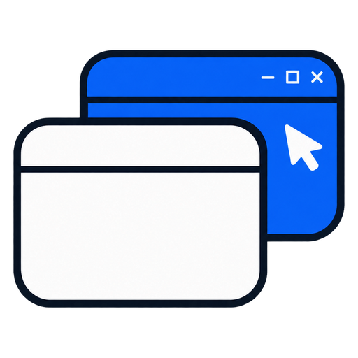
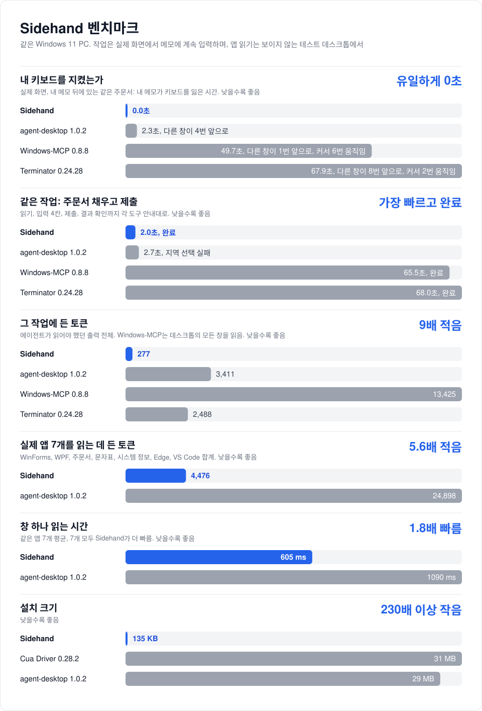

<p align="center">
  
</p>

<h1 align="center">Sidehand</h1>

<p align="center"><b>AI 에이전트는 뒤에서 Windows 앱을 다루고, 나는 하던 일을 계속합니다.</b></p>

<p align="center">
  <a href="https://www.npmjs.com/package/sidehand"></a>
  <a href="LICENSE"></a>
  
  
</p>

<p align="center"><a href="README.md">English</a> · <b>한국어</b> · <a href="README.zh-CN.md">简体中文</a></p>


Sidehand는 Claude, Codex, Cursor 같은 MCP 클라이언트가 지금 쓰고 있는 창 뒤의 Windows 앱을 읽고 조작하게 해 줍니다. 입력, 클릭, 목록 선택, 화면 읽기를 하면서도 내 마우스를 움직이거나 키보드를 가져가지 않습니다.

## 왜 Sidehand인가

- **방해하지 않습니다.** 내 창 뒤에 있는 창에서 일하고, 커서를 움직이지 않습니다. 앱이 스스로 앞으로 튀어나와도 내 창이 바로 다시 앞으로 돌아옵니다.
- **에이전트 여러 개가 동시에 일합니다.** MCP나 pi로 연결한 에이전트는 각자 세션이 따로라서 앱 3개를 한꺼번에 채울 수 있습니다. CLI 호출은 에이전트마다 `SIDEHAND_SESSION`을 다르게 지정하지 않으면 세션 하나를 같이 씁니다.
- **토큰을 적게 씁니다.** 컨트롤 하나를 짧은 한 줄로 돌려줍니다. 벤치마크 작업에서 Sidehand는 토큰 277개, 다른 도구는 2,488~13,425개를 썼습니다. 같은 창을 읽을 때는 일반적인 앱에서 agent-desktop보다 약 4~5배, Edge 페이지에서는 약 20배 적게 씁니다.
- **작고 내 PC 안에서만 돕니다.** 상주 프로그램, 사용 통계 전송, 내려받는 실행 파일이 없습니다. 반나절이면 다 읽을 수 있는 약 2,800줄입니다.

## 시작하기

MCP 클라이언트에 서버를 추가합니다. Windows 10 또는 11, Node 18.3 이상, [Git for Windows](https://git-scm.com/download/win)가 필요합니다. 아래 설정은 `npx`가 GitHub에서 Sidehand를 받아 오는데, 이때 Git을 씁니다.

```json
{
  "mcpServers": {
    "sidehand": { "command": "npx", "args": ["-y", "github:Blue-B/sidehand", "mcp"] }
  }
}
```

| 클라이언트 | 넣는 곳 |
|---|---|
| Claude Desktop | 설정 › 개발자 › 구성 편집 |
| Claude Code | `claude mcp add sidehand -- npx -y github:Blue-B/sidehand mcp` (네이티브 Windows에서도 그대로, `cmd /c` 필요 없음) |
| Cursor | `~/.cursor/mcp.json` |
| Codex | `codex mcp add sidehand -- npx -y github:Blue-B/sidehand mcp` 또는 `~/.codex/config.toml`의 `[mcp_servers.sidehand]`([예시](#만질-수-있는-창-제한)) |
| pi | `pi install git:github.com/Blue-B/sidehand` |

네이티브 Windows의 Claude Desktop, Cursor, Codex에서 서버가 시작되지 않으면 [문제 해결](#문제-해결)을 보세요.

설정 파일이 어디 있는지 모르겠다면 AI 에이전트에게 아래 문장을 그대로 붙여 넣으세요. 에이전트가 직접 설정합니다.

```text
Sidehand(https://github.com/Blue-B/sidehand)를 너 자신에게 설치해 줘. 네 MCP 설정에 이름이 "sidehand"이고
command가 "npx", args가 ["-y", "github:Blue-B/sidehand", "mcp"]인 MCP 서버를 추가해.
네가 Claude Code라면 `npm install -g github:Blue-B/sidehand`도 실행하고 README에 있는 `sidehand guard`
PreToolUse 훅도 추가해. 끝나면 내가 너를 다시 시작해야 하는지 알려 줘.
```

CLI를 쓰려면 `npm install -g github:Blue-B/sidehand` 후 `sidehand doctor`로 설치 상태를 확인하고, 에이전트에게 `sidehand tree`와 `sidehand act`를 쓰라고 알려 주세요([사용법](#사용법)).

**막힌 에이전트가 마우스를 뺏지 못하게 하기(Claude Code).** 동작이 실패하면 에이전트가 진짜 마우스를 움직이거나 앱을 앞으로 끌어오는 스크립트를 직접 짜기도 합니다. CLI를 설치하고 `.claude/settings.json`에 아래 훅을 넣으면 그런 Bash 명령을 막고 에이전트에게 대신 사용자에게 알리라고 전합니다(pi는 따로 설정 없이 먼저 사용자에게 묻습니다).

```json
{
  "hooks": {
    "PreToolUse": [{ "matcher": "Bash", "hooks": [{ "type": "command", "command": "sidehand guard" }] }]
  }
}
```

## 다른 도구와 비교

| | Sidehand | [Claude computer use](https://code.claude.com/docs/en/desktop#let-claude-use-your-computer) | [ChatGPT computer use](https://developers.openai.com/codex/app/computer-use) | [Cua Driver](https://cua.ai/cua-driver) | [agent-desktop](https://github.com/vercel-labs/agent-desktop) |
|---|:-:|:-:|:-:|:-:|:-:|
| 작업 중에도 내가 계속 입력 | ✅ 키보드를 뺏긴 시간 0초 | ❌ Windows에서는 작업하는 동안 다른 창을 숨김(백그라운드 사용은 macOS만) | ❌ Windows에서는 포인터를 움직이고 맨 앞 창을 가져감 | ❌ 0.28.2는 호출마다 콘솔 창이 떠서 맨 앞으로 옴 | ❌ 1.0.2는 창을 4번 앞으로 가져옴, 키보드를 뺏긴 시간 2.3초 |
| 가려진 창에서 작업 | ✅ | ❌ Windows에서는 앱을 가리는 창을 숨김 | ❌ Windows에서는 앱이 화면에 보여야 함 | ✅ 자체 문서 기준 | ✅ |
| 화면을 텍스트로 읽기 | ✅ | 스크린샷 | 스크린샷 | ✅ 자체 문서 기준 | ✅ |
| 지정한 영역 가리기(검정, 모자이크, 흐림) | ✅ | – | – | – | – |
| 지원 OS | Windows | macOS, Windows | macOS, Windows | macOS, Windows(미리 보기), Linux | macOS, Windows, Linux |

Sidehand와 agent-desktop은 직접 측정했습니다([docs/benchmark.ko.md](docs/benchmark.ko.md)). Cua Driver는 시도했지만 점수를 매기지 않았고, 벤치마크 문서에 콘솔 창 문제만 적었습니다. Claude와 ChatGPT computer use는 측정하지 않았습니다. 이 칸들과 Cua Driver의 "자체 문서 기준" 칸은 링크한 각 회사 문서의 내용입니다. –는 링크한 문서에 언급이 없고 시험하지도 않았다는 뜻입니다.



측정 방법은 [docs/benchmark.ko.md](docs/benchmark.ko.md)에 있습니다.

## 사용법

```console
$ sidehand tree "Contoso Orders"
window: Contoso Orders  (18 elements)
  e4 Edit "Customer"
  e8 ComboBox "Region"
  e12 Button "Submit order"

$ sidehand act e4 type "Blue-B Studio"
$ sidehand act e8 select Jeju
$ sidehand act e12 click
$ sidehand wait "Contoso Orders" "Order submitted"
```

| 명령 | 하는 일 |
|---|---|
| `tree <제목>` | 창의 컨트롤을 텍스트로, 각각 ref(`e1`, `e2`, ...)와 함께 |
| `act <ref> <동작> [값]` | `type <글자>`, `click`, `check`, `uncheck`, `select [항목]`, `expand`, `collapse`, `scroll`, `right-click`, `double-click`, `hover`, `wheel [up\|down N]`, `drag <ref\|dx,dy>`, `press <키>`; `focus`는 내 맨 앞 창을 가져가므로 `--allow-foreground`(사용자 허락)가 필요 |
| `ocr <제목>` | 직접 그리는 창(게임, Qt, 캔버스 앱)의 글자를 Windows OCR로 읽음, 줄마다 ref(`t1`, `t2`, ...)와 함께 |
| `act <t-ref> <동작>` | OCR ref에는 `click`, `double-click`, `right-click`, `hover`, `wheel`, `drag`, 글자 가운데를 대상으로. OCR ref는 `ocr` 실행 60초 뒤 만료 |
| `wait <제목> <글자>` | 그 글자가 있는 컨트롤이 나타날 때까지(또는 `--gone`) 기다림 |
| `window <제목> <동작>` | `move`, `resize`, `minimize`, `restore`(내 창 뒤로), `close` |
| `launch <앱>` | 포커스를 가져가지 않게 앱 실행 |
| `capture <방식>` | 가려진 창도 스크린샷(`full`, `active`, `monitor`, `region`, `window`), WSL에서는 `%LOCALAPPDATA%\sidehand\captures`, Windows에서는 `%TEMP%\sidehand`에 저장되고 하루 지난 캡처는 지워짐. 네트워크 공유 경로의 이미지는 거절 |
| `mask <png> <x,y,w,h[;...]>` | 스크린샷을 공유하기 전에 지정한 영역을 가림, `--style black`, `pixelate`, `blur` |
| `windows`, `clipboard` | 창 목록, 클립보드 읽기와 쓰기 |
| `doctor`, `--version` | 설치 상태 확인([문제 해결](#문제-해결) 참고), 버전 출력 |

`<제목>`에는 창 제목의 일부, 정확한 제목, 또는 창 핸들(`sidehand windows`에 나오는 `0x...`)을 쓸 수 있습니다. MCP와 pi에서는 같은 기능을 도구로 씁니다(`ui_tree`, `ui_ocr`, `ui_act`, `capture`, `mask` 등).

### 만질 수 있는 창 제한

`SIDEHAND_ALLOW`에 창 제목을 `;`로 구분해 넣으면(예: `"Contoso Orders;Notepad"`) 나머지 창은 에이전트에게 보이지 않습니다. 이때 전체 화면과 영역 캡처, `launch`, 클립보드는 꺼집니다. MCP 설정에서는 이렇게 씁니다.

```json
"sidehand": { "command": "npx", "args": ["-y", "github:Blue-B/sidehand", "mcp"], "env": { "SIDEHAND_ALLOW": "Notepad" } }
```

Codex(`~/.codex/config.toml`)에서는 이렇게 씁니다.

```toml
[mcp_servers.sidehand]
command = "npx"
args = ["-y", "github:Blue-B/sidehand", "mcp"]
env = { SIDEHAND_ALLOW = "Notepad" }
```

명령줄로는 `codex mcp add sidehand --env SIDEHAND_ALLOW=Notepad -- npx -y github:Blue-B/sidehand mcp`입니다(Claude Code도 같은 `--env` 옵션을 받습니다).

## 뒤에서 되는 것

| | Win32, WinForms | WPF | Chrome, Edge | VS Code |
|---|:-:|:-:|:-:|:-:|
| 입력, 클릭, 체크, 선택, 펼치기 | ✅ | ✅ | ✅ (`<select>` 제외) | ✅ 클릭 |
| 휠, 더블클릭 | ✅ | ✅ UI Automation으로 | ✅ | – |
| 우클릭, 호버, 드래그 | ✅ | ❌ | ✅ | – |
| 키와 단축키 | ✅ | 버튼·링크에서 Enter, 나머지는 허락 필요 | 버튼·링크에서 Enter, 나머지는 허락 필요 | 허락 필요 |

WPF는 진짜 마우스가 아닌 마우스 메시지를 무시합니다. 그래서 WPF에서 휠은 가장 가까운 스크롤 가능한 목록이나 뷰를 UI Automation으로 스크롤하고, 더블클릭은 요소의 기본 동작(Invoke: 표의 행은 편집 시작, 버튼은 클릭)을 실행합니다. 앱이 직접 단 더블클릭 처리기는 실행되지 않습니다. WPF의 우클릭, 호버, 드래그는 거절합니다. UI Automation의 컨텍스트 메뉴 호출은 창을 앞으로 가져오기 때문입니다. WPF와 웹 페이지는 포커스가 있을 때만 키를 받아서 키에는 `--allow-foreground`(사용자 허락)가 필요하지만, 버튼이나 링크에서 Enter는 그 버튼을 누릅니다. WPF는 기본 버튼이 무엇인지 UI Automation에 알려주지 않아서 텍스트 상자에서 Enter도 허락이 필요합니다. 게임처럼 화면을 직접 그리는 앱(Qt, 캔버스)은 컨트롤이 보이지 않습니다. 이때 `ocr`이 Windows 기본 OCR로 글자를 읽고, `act`가 그 글자에 메시지로 보낸 마우스 입력으로 클릭, 더블클릭, 우클릭, 호버, 휠, 드래그를 합니다.

### 한계

- WPF: 우클릭, 호버, 드래그는 거절하고, 앱이 직접 단 더블클릭 처리기는 실행되지 않습니다.
- WPF: 텍스트 상자에서 Enter는 다른 키처럼 사용자 허락(`--allow-foreground`)이 필요합니다.
- Chrome, Edge: HTML `<select>` 드롭다운은 뒤에서 조작할 수 없습니다.
- 마우스 입력을 직접(raw input) 읽는 게임은 메시지로 보낸 클릭을 무시합니다. `capture`와 `ocr`은 됩니다.
- 관리자 권한으로 실행된 앱은 에이전트도 관리자 권한으로 실행해야 합니다.
- 최소화된 창은 먼저 `window <제목> restore`로 되돌려야 합니다. 되돌린 창은 내 창 뒤에 놓입니다.

## 동작 방식

Sidehand는 화면 낭독기가 쓰는 UI Automation 클라이언트이고, 처음 쓸 때 내 PC에서 컴파일됩니다. 일반 컨트롤에는 창 메시지(`WM_SETTEXT`, `BM_CLICK` 등)를 보내는데, 창 메시지는 창을 활성화하지 않습니다. 나머지 컨트롤은 대상 창을 잠깐 "활성화 금지"로 표시한 상태에서 UI Automation으로 조작해서, 앱이 스스로 앞으로 나오지 못합니다. 클릭과 키는 앱의 메시지 큐로 보내고 내 마우스는 건드리지 않습니다. 그래도 앱이 억지로 앞으로 나오면, 키보드나 마우스를 건드리지 않고 맨 앞 자리를 내 창에 돌려줍니다.

**보안.** 다른 창에서 읽은 글자는 에이전트에게 그대로 전달되므로 웹 페이지 내용처럼 다뤄야 합니다. 페이지나 메시지가 에이전트에게 지시를 내리려 할 수 있습니다. `SIDEHAND_ALLOW`로 보이는 창을 제한할 수 있고, PowerShell로 넘기는 모든 문자열은 따옴표(꼬부라진 따옴표 포함)로 감싸거나 거절합니다.

## 문제 해결

먼저 `sidehand doctor`(또는 `npx -y github:Blue-B/sidehand doctor`)를 실행하세요. Node, WSL 연동, PowerShell, 실행 정책(그룹 정책 포함), 언어 모드, 관리자 권한 여부, 엔진, 설치된 OCR 언어를 확인합니다. 창은 건드리지 않고, 실패한 항목이 있으면 종료 코드 1을 돌려줍니다.

- **네이티브 Windows의 Claude Desktop, Cursor, Codex에서 서버가 시작되지 않음**(예: `spawn npx ENOENT`). Windows에서 `npx`는 `.cmd` 스크립트라서, 셸 없이 실행하는 프로그램은 `ENOENT`를 받습니다. `"command": "cmd"`, `"args": ["/c", "npx", "-y", "github:Blue-B/sidehand", "mcp"]`로 바꾸세요(Codex TOML에서는 `command = "cmd"`, `args = ["/c", "npx", ...]`). Claude Code는 `npx`를 그대로 써도 됩니다.
- **Codex가 시작 시간 초과를 알림.** Codex는 서버 시작을 10초 기다립니다. 처음 `npx`로 내려받을 때는 더 걸릴 수 있으니 `[mcp_servers.sidehand]` 아래에 `startup_timeout_sec = 60`을 넣으세요.
- **`sidehand worker exited` 또는 "이 시스템에서 스크립트를 실행할 수 없으므로"(running scripts is disabled on this system).** Sidehand는 PowerShell을 `-ExecutionPolicy Bypass`로 실행하지만, 그룹 정책으로 정한 실행 정책이 이를 덮어씁니다. `Get-ExecutionPolicy -List`에서 `MachinePolicy`나 `UserPolicy`로 보이며, 관리자만 바꿀 수 있습니다.
- **제한된 언어 모드(Constrained Language Mode)**(AppLocker나 WDAC가 설정): PowerShell이 `Add-Type`을 막아서 Sidehand가 엔진을 만들 수 없습니다. 지원하지 않습니다. 켜져 있으면 `$ExecutionContext.SessionState.LanguageMode`가 `ConstrainedLanguage`를 보여 줍니다.
- **WSL**: Sidehand는 WSL interop으로 `powershell.exe`를 실행하므로 `/etc/wsl.conf`에서 interop과 `appendWindowsPath`가 켜져 있어야 합니다(기본값은 켜짐).
- **`ocr`이 "Windows OCR has no language installed"를 알림.** Windows OCR은 Windows 프로필에 있는 언어의 OCR 언어 팩이 필요합니다. `Get-WindowsCapability -Online -Name Language.OCR*`로 목록을 보고, 관리자 PowerShell에서 `Add-WindowsCapability -Online -Name "Language.OCR~~~ko-KR~0.0.1.0"`처럼 추가하세요.
- **관리자 권한으로 실행된 앱이 반응하지 않음.** Windows는 일반 프로세스가 관리자 권한 프로세스에 입력을 보내지 못하게 막습니다. 에이전트도 관리자 권한으로 실행하세요.
- **첫 호출이 느림.** 첫 호출 때 엔진을 `%LOCALAPPDATA%\sidehand`에 컴파일하고, 그 뒤로는 다시 씁니다.

## 라이선스

[FSL-1.1-MIT](LICENSE)(Functional Source License). 회사 업무를 포함해 어떤 용도로든 쓰고 고치고 공유할 수 있습니다. 다만 Sidehand나 이를 바탕으로 만든 제품을 경쟁하는 상용 제품이나 서비스로 제공하는 것은 안 됩니다. 예를 들어 회사가 자기 직원들의 에이전트로 사내 앱을 다루려고 Sidehand를 쓰거나, 컨설턴트가 고객사에 설치해 주는 것은 됩니다. Sidehand를 바탕으로 같은 기능을 하는 데스크톱 에이전트 제품을 팔거나 호스팅 서비스로 제공하는 것은 안 됩니다. 각 버전은 출시 2년 뒤 MIT로 바뀝니다. 상업용 라이선스가 필요하면 이슈를 남겨 주세요.
