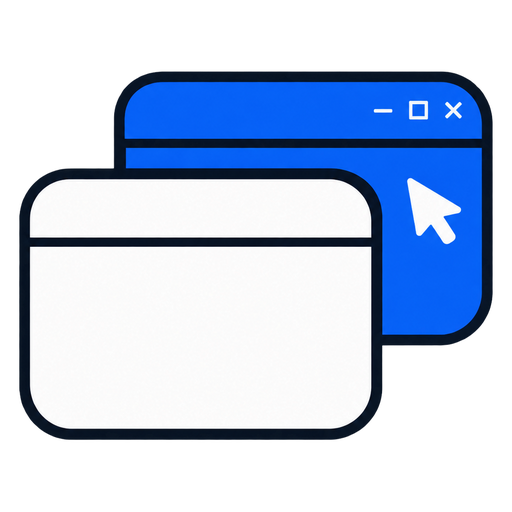
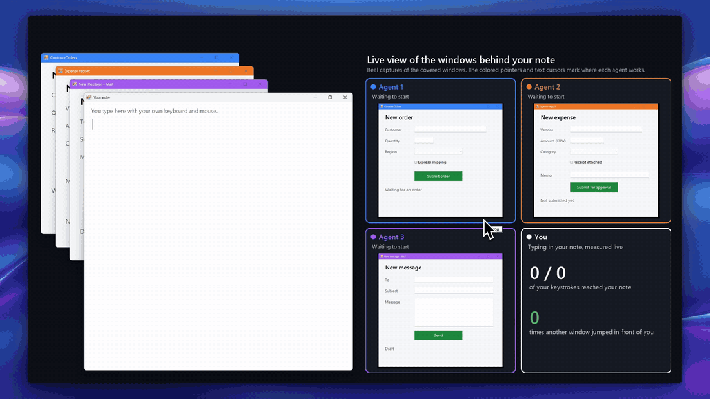
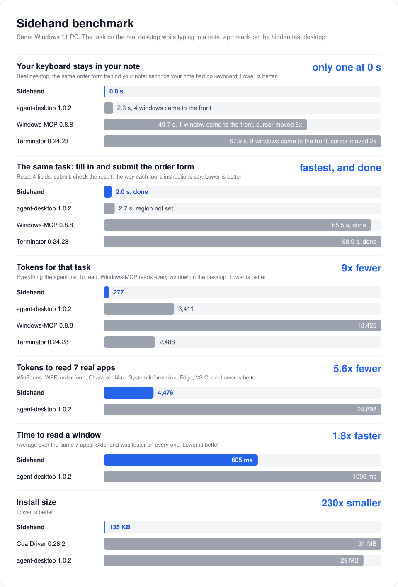

<p align="center">
  
</p>

<h1 align="center">Sidehand</h1>

<p align="center"><b>Your AI agent works in your Windows apps. You keep the keyboard.</b></p>

<p align="center">
  <a href="https://www.npmjs.com/package/sidehand"></a>
  <a href="LICENSE"></a>
  
  
</p>

<p align="center"><b>English</b> · <a href="README.ko.md">한국어</a> · <a href="README.zh-CN.md">简体中文</a></p>



Sidehand lets Claude, Codex, Cursor or any MCP client read and operate Windows apps behind the window you are using. It types, clicks, picks from lists and reads the screen as text without moving your mouse or taking your keyboard.

## Why Sidehand

- **Stays out of your way.** It works in windows behind yours and never moves your cursor. If an app pulls itself to the front anyway, your window goes straight back in front.
- **Several agents at once.** Each agent connected through MCP or pi gets its own session, so three apps can be filled in at the same time. CLI calls share one session unless each agent sets its own `SIDEHAND_SESSION`.
- **Cheap to read.** One short line per control. The benchmark task took 277 tokens with Sidehand and 2,488 to 13,425 with the other tools. Reading the same window takes about 4 to 5 times fewer tokens than agent-desktop on typical apps, and about 20 times fewer on an Edge page.
- **Small and local.** No daemon, no telemetry, no downloaded binary. About 2,800 lines you can read in an afternoon.

## Quick start

Add the MCP server to your client. You need Windows 10 or 11, Node 18.3+ and [Git for Windows](https://git-scm.com/download/win): the line below makes `npx` fetch Sidehand from GitHub, which needs Git.

```json
{
  "mcpServers": {
    "sidehand": { "command": "npx", "args": ["-y", "github:Blue-B/sidehand", "mcp"] }
  }
}
```

| Client | Where |
|---|---|
| Claude Desktop | Settings › Developer › Edit Config |
| Claude Code | `claude mcp add sidehand -- npx -y github:Blue-B/sidehand mcp` (also on native Windows, no `cmd /c` needed) |
| Cursor | `~/.cursor/mcp.json` |
| Codex | `codex mcp add sidehand -- npx -y github:Blue-B/sidehand mcp`, or `[mcp_servers.sidehand]` in `~/.codex/config.toml` ([example](#limit-what-it-can-touch)) |
| pi | `pi install git:github.com/Blue-B/sidehand` |

If Claude Desktop, Cursor or Codex on native Windows cannot start the server, see [Troubleshooting](#troubleshooting).

Not sure where your client keeps that file? Paste this to your AI agent and it sets itself up:

```text
Install Sidehand (https://github.com/Blue-B/sidehand) for yourself: add an MCP server named "sidehand"
with command "npx" and args ["-y", "github:Blue-B/sidehand", "mcp"] to your own MCP settings.
If you are Claude Code, also run `npm install -g github:Blue-B/sidehand` and add the `sidehand guard`
PreToolUse hook from the README. Then tell me whether I need to restart you.
```

Prefer a CLI? `npm install -g github:Blue-B/sidehand`, run `sidehand doctor` to check your setup, then tell your agent to use `sidehand tree` and `sidehand act` (see [Usage](#usage)).

**Keep a stuck agent off your mouse (Claude Code).** When an action fails, an agent may write its own script that moves the real mouse or pulls the app forward. With the CLI installed, this hook in `.claude/settings.json` blocks such Bash commands and tells the agent to ask you instead (pi does this on its own and asks you first):

```json
{
  "hooks": {
    "PreToolUse": [{ "matcher": "Bash", "hooks": [{ "type": "command", "command": "sidehand guard" }] }]
  }
}
```

## How it compares

| | Sidehand | [Claude computer use](https://code.claude.com/docs/en/desktop#let-claude-use-your-computer) | [ChatGPT computer use](https://developers.openai.com/codex/app/computer-use) | [Cua Driver](https://cua.ai/cua-driver) | [agent-desktop](https://github.com/vercel-labs/agent-desktop) |
|---|:-:|:-:|:-:|:-:|:-:|
| You keep typing while it works | ✅ 0 s without the keyboard | ❌ on Windows it hides your other windows while it works (background use is macOS only) | ❌ on Windows it moves the pointer and takes the foreground | ❌ 0.28.2 opened a console window that took the foreground on every call | ❌ 1.0.2 brought windows forward 4 times, 2.3 s without the keyboard |
| Works on windows that are covered | ✅ | ❌ on Windows it hides the windows over the app | ❌ on Windows the app must stay visible | ✅ by its docs | ✅ |
| Reads apps as text | ✅ | screenshots | screenshots | ✅ by its docs | ✅ |
| Masks regions you choose (black, pixelate, blur) | ✅ | – | – | – | – |
| Runs on | Windows | macOS, Windows | macOS, Windows | macOS, Windows (preview), Linux | macOS, Windows, Linux |

Sidehand and agent-desktop were measured: see [docs/benchmark.md](docs/benchmark.md). Cua Driver was tried but not scored; the benchmark notes its console window. Claude and ChatGPT computer use were not measured: their cells say what the linked vendor pages say, and so do the Cua Driver cells marked "by its docs". – means the linked page does not mention it and it was not tested.



How each number was measured: [docs/benchmark.md](docs/benchmark.md).

## Usage

```console
$ sidehand tree "Contoso Orders"
window: Contoso Orders  (18 elements)
  e4 Edit "Customer"
  e8 ComboBox "Region"
  e12 Button "Submit order"

$ sidehand act e4 type "Blue-B Studio"
$ sidehand act e8 select Jeju
$ sidehand act e12 click
$ sidehand wait "Contoso Orders" "Order submitted"
```

| Command | What it does |
|---|---|
| `tree <title>` | the window's controls as text, each with a ref (`e1`, `e2`, ...) |
| `act <ref> <action> [value]` | `type <text>`, `click`, `check`, `uncheck`, `select [item]`, `expand`, `collapse`, `scroll`, `right-click`, `double-click`, `hover`, `wheel [up\|down N]`, `drag <ref\|dx,dy>`, `press <keys>`; `focus` takes your foreground window, so it needs `--allow-foreground` (your consent) |
| `ocr <title>` | the text of a custom-drawn window (games, Qt, canvas apps) read by Windows OCR, each line with a ref (`t1`, `t2`, ...) |
| `act <t-ref> <action>` | on an OCR ref: `click`, `double-click`, `right-click`, `hover`, `wheel`, `drag`, at the center of the text; OCR refs expire 60 s after the `ocr` that made them |
| `wait <title> <text>` | wait until a control with that text appears (or `--gone`) |
| `window <title> <action>` | `move`, `resize`, `minimize`, `restore` (behind your windows), `close` |
| `launch <app>` | start an app without it taking your focus |
| `capture <mode>` | screenshot a window even while it is covered (`full`, `active`, `monitor`, `region`, `window`); saved in `%LOCALAPPDATA%\sidehand\captures` (from WSL) or `%TEMP%\sidehand` (on Windows), where captures older than a day are deleted; image paths on a network share are refused |
| `mask <png> <x,y,w,h[;...]>` | cover regions you choose in a screenshot before sharing it, with `--style black`, `pixelate` or `blur` |
| `windows`, `clipboard` | list windows, read or set the clipboard |
| `doctor`, `--version` | check your setup (see [Troubleshooting](#troubleshooting)), print the version |

`<title>` can be part of a window's title, its exact title, or its handle (`0x...` from `sidehand windows`). MCP and pi expose the same operations as tools (`ui_tree`, `ui_ocr`, `ui_act`, `capture`, `mask`, ...).

### Limit what it can touch

Set `SIDEHAND_ALLOW` to a list of window titles separated by `;` (for example `"Contoso Orders;Notepad"`), and every other window disappears from its view. Full-screen and region captures, `launch` and the clipboard are then off. In an MCP config:

```json
"sidehand": { "command": "npx", "args": ["-y", "github:Blue-B/sidehand", "mcp"], "env": { "SIDEHAND_ALLOW": "Notepad" } }
```

In Codex (`~/.codex/config.toml`):

```toml
[mcp_servers.sidehand]
command = "npx"
args = ["-y", "github:Blue-B/sidehand", "mcp"]
env = { SIDEHAND_ALLOW = "Notepad" }
```

Or on the command line: `codex mcp add sidehand --env SIDEHAND_ALLOW=Notepad -- npx -y github:Blue-B/sidehand mcp` (Claude Code takes the same `--env` option).

## What works in the background

| | Win32, WinForms | WPF | Chrome, Edge | VS Code |
|---|:-:|:-:|:-:|:-:|
| Type, click, check, select, expand | ✅ | ✅ | ✅ except `<select>` | ✅ click |
| Wheel, double-click | ✅ | ✅ through UI Automation | ✅ | – |
| Right-click, hover, drag | ✅ | ❌ | ✅ | – |
| Keys and shortcuts | ✅ | Enter on a button or link; others with consent | Enter on a button or link; others with consent | with consent |

WPF ignores mouse messages that do not come from the real mouse, so on WPF a wheel scrolls the nearest scrollable list or view through UI Automation, and a double-click runs the element's default action (Invoke: a grid row starts editing, a button clicks); an app's own double-click handler does not run. Right-click, hover and drag on WPF are refused: UI Automation's context-menu call brings the window forward. WPF and browser pages take keys only while focused, so keys need `--allow-foreground`, except Enter on a button or link, which presses it. WPF does not tell UI Automation which button is the default, so Enter in a text box needs consent too. Games and other apps that draw their own UI (Qt, canvas) expose no controls: `ocr` reads their text with the built-in Windows OCR, and `act` clicks, double-clicks, right-clicks, hovers, wheels or drags on it with posted mouse messages.

### Limitations

- WPF: right-click, hover and drag are refused, and an app's own double-click handler does not run.
- WPF: Enter in a text box, like other keys, needs your consent (`--allow-foreground`).
- Chrome and Edge: an HTML `<select>` drop-down cannot be operated in the background.
- Games that read raw mouse input ignore posted clicks. `capture` and `ocr` still work.
- Apps running as administrator need an agent running as administrator.
- A minimized window has to be brought back first with `window <title> restore`, which puts it behind your windows.

## How it works

Sidehand is a UI Automation client, the same interface screen readers use, compiled on your PC on first use. Classic controls get plain window messages (`WM_SETTEXT`, `BM_CLICK`, ...), which never activate a window. Everything else gets a UI Automation call while the target window is marked no-activate, so the app cannot pull itself to the front. Clicks and keys are posted to the app's own message queue, never to your mouse. If an app forces itself forward anyway, Sidehand hands the foreground back to your window without touching the keyboard or mouse.

**Security.** Text Sidehand reads from other windows goes to your agent, so treat it like web content: a page or message can try to instruct the agent. `SIDEHAND_ALLOW` limits which windows it sees, and every string it passes to PowerShell is quoted (including typographic quotes) or refused.

## Troubleshooting

Run `sidehand doctor` (or `npx -y github:Blue-B/sidehand doctor`) first. It checks Node, WSL interop, PowerShell, the execution policy (including Group Policy), the language mode, whether the shell is elevated, the engine and the installed OCR languages, touches no window, and exits 1 if a check fails.

- **The server does not start in Claude Desktop, Cursor or Codex on native Windows** (for example `spawn npx ENOENT`). On Windows `npx` is a `.cmd` script, and a program that starts it without a shell gets `ENOENT`. Use `"command": "cmd"` with `"args": ["/c", "npx", "-y", "github:Blue-B/sidehand", "mcp"]` (in Codex TOML: `command = "cmd"`, `args = ["/c", "npx", ...]`). Claude Code starts plain `npx` fine.
- **Codex reports a startup timeout.** Codex waits 10 seconds for a server to start. The first `npx` download can take longer; add `startup_timeout_sec = 60` under `[mcp_servers.sidehand]`.
- **`sidehand worker exited` or "running scripts is disabled on this system".** Sidehand starts PowerShell with `-ExecutionPolicy Bypass`, but an execution policy set by Group Policy overrides that. `Get-ExecutionPolicy -List` shows it as `MachinePolicy` or `UserPolicy`; only your administrator can change it.
- **Constrained Language Mode** (set by AppLocker or WDAC): PowerShell blocks `Add-Type`, so Sidehand cannot build its engine. This is not supported. `$ExecutionContext.SessionState.LanguageMode` shows `ConstrainedLanguage` when it is on.
- **WSL**: Sidehand runs `powershell.exe` through WSL interop, so interop and `appendWindowsPath` must stay on in `/etc/wsl.conf` (they are on by default).
- **`ocr` says "Windows OCR has no language installed".** Windows OCR needs an OCR language pack for a language in your Windows profile. List them with `Get-WindowsCapability -Online -Name Language.OCR*` and add one from an administrator PowerShell, for example `Add-WindowsCapability -Online -Name "Language.OCR~~~en-US~0.0.1.0"`.
- **An app running as administrator does not respond.** Windows blocks a normal process from sending input to an elevated one. Run your agent as administrator too.
- **The first call is slow.** The first call compiles the engine into `%LOCALAPPDATA%\sidehand`; later calls reuse it.

## License

[FSL-1.1-MIT](LICENSE) (Functional Source License). Use, change and share Sidehand for anything, including at work, except offering it, or a product built on it, as a competing commercial product or service. Allowed, for example: a company runs Sidehand so its own staff's agents operate its internal apps, or a consultant sets it up for a client. Not allowed: selling a desktop-agent product, or running a hosted service, built on Sidehand that offers the same functionality. Each version becomes MIT two years after its release. For a commercial license, open an issue.
