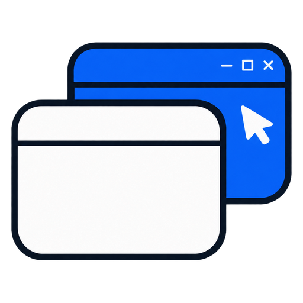
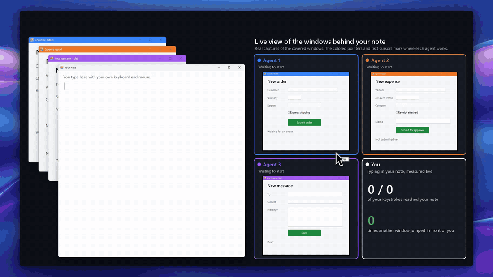

<p align="center">
  
</p>

<h1 align="center">Sidehand</h1>

<p align="center"><b>AI 智能体在后台操作你的 Windows 应用，键盘始终在你手里。</b></p>

<p align="center">
  <a href="https://www.npmjs.com/package/sidehand"></a>
  <a href="LICENSE"></a>
  
  
</p>

<p align="center"><a href="README.md">English</a> | <a href="README.ko.md">한국어</a> | <b>简体中文</b></p>



Sidehand 让 Claude、Codex、Cursor 或任何 MCP 客户端读取并操作你当前窗口后面的 Windows 应用。它可以输入文字、点击、从列表中选择，并把界面读成文本，全程不移动你的鼠标，也不抢你的键盘。

## 为什么用 Sidehand

- 在基准测试任务中，你的便笺始终握着键盘：被占用 0 秒，没有窗口跳到前台，光标一次也没动。
- 它在被你的窗口遮住的窗口里工作，你可以继续使用前面的窗口。
- 每个控件只占一行短文本：同一任务 Sidehand 用了 277 个 token，其他工具用了 2,488 到 13,425 个。读取一个窗口时，在常见应用上 token 用量约为 agent-desktop 的 1/4 到 1/5，在 Edge 网页上约为 1/20。
- 它用 2.0 秒完成任务。另外两个完成任务的工具 Windows-MCP 和 Terminator 分别用了 65.5 秒和 68.0 秒。

## 快速开始

需要 Windows 10 或 11 和 Node 18.3+。把服务器加到你的 MCP 客户端：

```json
{
  "mcpServers": {
    "sidehand": { "command": "npx", "args": ["-y", "sidehand", "mcp"] }
  }
}
```

| 客户端 | 配置位置 |
|---|---|
| Claude Code | `claude mcp add sidehand -- npx -y sidehand mcp` |
| Cursor | `~/.cursor/mcp.json` |
| Codex | `codex mcp add sidehand -- npx -y sidehand mcp` |
| Claude Desktop | 设置 › 开发者 › 编辑配置 |
| pi | `pi install git:github.com/Blue-B/sidehand` |

在原生 Windows 上，Claude Desktop、Cursor 和 Codex 需要用 `cmd /c npx` 启动。这一设置以及 Codex TOML、CLI、Claude Code 的 guard 钩子和 `SIDEHAND_ALLOW` 见 [docs/setup.md](docs/setup.md)（英文）。

也可以把下面这段话发给你的 AI 智能体，它会自己完成设置：

```text
帮你自己安装 Sidehand（https://github.com/Blue-B/sidehand）：在你的 MCP 设置里添加一个名为 "sidehand" 的
MCP 服务器，command 为 "npx"，args 为 ["-y", "sidehand", "mcp"]。
如果你是 Claude Code，还要运行 `npm install -g sidehand`，并添加该仓库 docs/setup.md 里的
`sidehand guard` PreToolUse 钩子。完成后告诉我是否需要重启你。
```

用 `sidehand doctor`（或 `npx -y sidehand doctor`）检查环境。

## 与其他方案对比

| | Sidehand | [Claude computer use](https://code.claude.com/docs/en/desktop#let-claude-use-your-computer) | [ChatGPT computer use](https://developers.openai.com/codex/app/computer-use) | [agent-desktop](https://github.com/vercel-labs/agent-desktop) |
|---|:-:|:-:|:-:|:-:|
| 它工作时你能继续打字 | ✅ | ❌ 在 Windows 上会隐藏你的其他窗口 | ❌ 在 Windows 上会移动指针并占据前台 | ❌ 窗口跳到前台 4 次 |
| 能操作被遮住的窗口 | ✅ | ❌ 在 Windows 上不行 | ❌ 在 Windows 上不行 | ✅ |
| 以文本方式读取应用 | ✅ | 截图 | 截图 | ✅ |

Sidehand 和 agent-desktop 经过实测（[docs/benchmark.md](docs/benchmark.md)，英文），computer use 两列的内容来自所链接的厂商页面。更多工具和全部来源见 [docs/comparison.md](docs/comparison.md)（英文）。

## 用法

```console
$ sidehand tree "Contoso Orders"
window: Contoso Orders  (18 elements)
  e4 Edit "Customer"
  e12 Button "Submit order"

$ sidehand act e4 type "Blue-B Studio"
$ sidehand act e12 click
```

| 命令 | 作用 |
|---|---|
| `tree <标题>` | 以文本列出窗口中的控件，每个带一个 ref（`e4`） |
| `act <ref> <动作> [值]` | `type`、`click`、`select`、`check`、`press`、`wheel`、`drag` 等 |
| `ocr <标题>` | 用 Windows OCR 读取自绘窗口（游戏、Qt、画布）中的文字，带可供 `act` 点击的 ref（`t1`） |
| `wait <标题> <文字>` | 等待包含该文字的控件出现（或用 `--gone` 等它消失） |
| `window`、`launch` | 移动、调整大小、恢复或关闭窗口；启动应用且不抢焦点 |
| `capture`、`mask` | 给被遮住的窗口截图；用黑块、像素化或模糊遮盖区域 |
| `doctor` | 检查环境 |

MCP 和 pi 以工具形式提供同样的功能（`ui_tree`、`ui_ocr`、`ui_act` 等）。全部命令和选项见 [docs/usage.md](docs/usage.md)（英文）。

## 后台可以做什么

| | Win32、WinForms | WPF | Chrome、Edge | VS Code |
|---|:-:|:-:|:-:|:-:|
| 输入、点击、勾选、选择、展开 | ✅ | ✅ | ✅（`<select>` 除外） | ✅ 点击 |
| 滚轮、双击 | ✅ | ✅ 通过 UI Automation | ✅ | - |
| 右键、悬停、拖动 | ✅ | ❌ | ✅ | - |
| 按键和快捷键 | ✅ | 按钮或链接上的 Enter；其他需要同意 | 按钮或链接上的 Enter；其他需要同意 | 需要同意 |

“同意”指 `--allow-foreground`，即允许它占据前台。
直接读取原始鼠标输入（raw input）的游戏会忽略投递的点击，但 `capture` 和 `ocr` 仍然可用。
以管理员身份运行的应用需要智能体也以管理员身份运行。详情见 [docs/usage.md](docs/usage.md#what-works-in-the-background)（英文）。

## 故障排除

先运行 `sidehand doctor`。它检查 Node、WSL、PowerShell、执行策略、引擎和 OCR 语言，不会操作任何窗口。

- 原生 Windows 上出现 `spawn npx ENOENT`：用 `cmd /c npx` 启动服务器（[docs/setup.md](docs/setup.md#native-windows-claude-desktop-cursor-codex)）。
- Codex 启动超时：在 `[mcp_servers.sidehand]` 下加上 `startup_timeout_sec = 60`。
- “在此系统上禁止运行脚本”：执行策略由组策略设置，只有管理员能更改。
- `ocr` 提示没有安装语言：添加 Windows OCR 语言包。
- 以管理员身份运行的应用没有反应：请也以管理员身份运行智能体。

更多见 [docs/troubleshooting.md](docs/troubleshooting.md)（英文）。

## 安全

Sidehand 从其他窗口读到的文字会交给你的智能体，请像对待网页内容一样对待它：网页或消息可能试图向智能体下指令。
`SIDEHAND_ALLOW` 可以限制它能看到的窗口；它传给 PowerShell 的每个字符串都会加引号，否则直接拒绝。

## 许可证

[PolyForm Shield 1.0.0](LICENSE)。可以免费用于任何目的，包括在工作中使用；但不能构建或提供与 Sidehand 竞争、或与 Blue-B 用 Sidehand 提供的产品竞争的产品，无论免费还是收费。
其中包含专利许可；任何声称 Sidehand 侵犯专利的人，其专利许可随即终止。
如需商业许可，请提交 issue。
