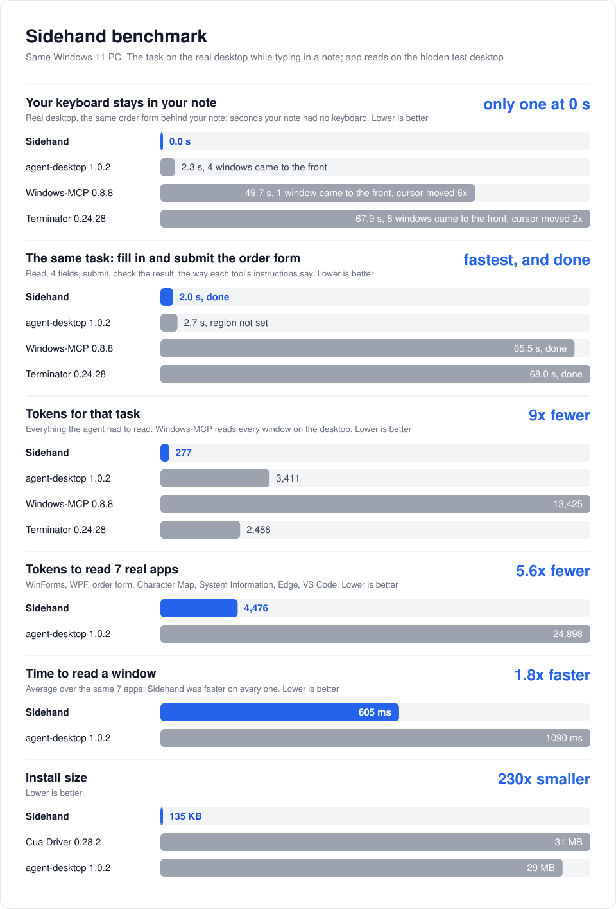

# How Sidehand compares

| | Sidehand | [Claude computer use](https://code.claude.com/docs/en/desktop#let-claude-use-your-computer) | [ChatGPT computer use](https://developers.openai.com/codex/app/computer-use) | [Cua Driver](https://cua.ai/cua-driver) | [agent-desktop](https://github.com/vercel-labs/agent-desktop) |
|---|:-:|:-:|:-:|:-:|:-:|
| You keep typing while it works | ✅ 0 s without the keyboard | ❌ on Windows it hides your other windows while it works (background use is macOS only) | ❌ on Windows it moves the pointer and takes the foreground | ❌ 0.28.2 opened a console window that took the foreground on every call | ❌ 1.0.2 brought windows forward 4 times, 2.3 s without the keyboard |
| Works on windows that are covered | ✅ | ❌ on Windows it hides the windows over the app | ❌ on Windows the app must stay visible | ✅ by its docs | ✅ |
| Reads apps as text | ✅ | screenshots | screenshots | ✅ by its docs | ✅ |
| Masks regions you choose (black, pixelate, blur) | ✅ | not mentioned | not mentioned | not mentioned | not mentioned |
| Runs on | Windows | macOS, Windows | macOS, Windows | macOS, Windows (preview), Linux | macOS, Windows, Linux |

## Sources

- Sidehand and agent-desktop were measured on one PC: see [benchmark.md](benchmark.md). The same task also ran with Windows-MCP and Terminator; their numbers are there too.
- Cua Driver was tried but not scored; the benchmark notes its console window. The cells marked "by its docs" come from its linked page.
- Claude and ChatGPT computer use were not measured. Their cells say what the linked vendor pages say.
- "not mentioned" means the linked page does not mention it and it was not tested.

